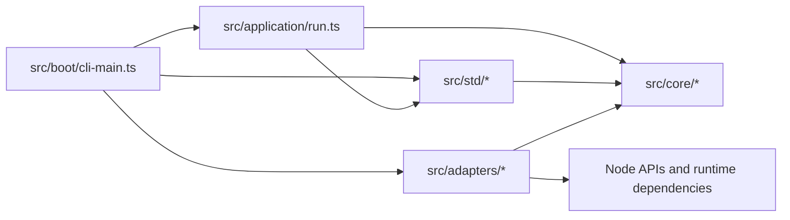

# Architecture

pathsift is one CLI package with TypeScript source and a hexagonal dependency direction.

## Source layout

Generated from the repository root with the locally installed `pathsift tree src --parent ""`. This loads the root `.gitignore` before scanning `src/`. The machine-specific absolute root line is shown as `src/`, and the totals line is omitted.

```text
src/
├── adapters/
│   ├── output/
│   │   ├── cli-help.ts
│   │   ├── terminal-output.ts
│   │   └── tree-line-renderer.ts
│   ├── archive-streams.ts
│   ├── config.ts
│   ├── content-classifier.ts
│   ├── ignore-walker.ts
│   ├── nano.ts
│   └── node-filesystem.ts
├── application/
│   └── run.ts
├── boot/
│   ├── cli-main.ts
│   └── where-options.ts
├── core/
│   ├── buffer-policy.ts
│   ├── content-kind.ts
│   ├── find-filter.ts
│   ├── output.ts
│   ├── path-policy.ts
│   ├── ports.ts
│   ├── tree-digest.ts
│   └── where-matcher.ts
└── std/
    ├── bounded-output-stager.ts
    └── tree-line-stack.ts
```

## Dependency direction



The checkout launcher `bin/pathsift.cjs` runs `src/boot/cli-main.ts` on Node 24+ and compiled `dist/boot/cli-main.js` on Node 22–23.

The application receives a `CommandPorts` object with path resolution, path checks, `walk`, destination prechecks, hashing, copy, and archive operations. It returns a `CommandOutput` value containing asynchronous semantic chunks or completed text/JSON rather than printing. The boot layer parses CLI arguments, constructs the Node adapter, and hands the result to the output adapter. Global and command-specific Help share one structured `HelpDocument` registry and serializer in the output adapter. Semantic lines contain separate code syntax and plain explanation parts: Ink colors only code parts on a TTY, while pipes wrap those parts in backticks without ANSI codes. The adapter measures its target's columns and stacks descriptions beneath syntax when two columns would overflow. Only the adapter inspects the target stream for TTY support.

The archive port is implemented entirely in the Node adapter. It sequences ZIP or TAR entries, propagates optional gzip and output errors, and returns only after the destination stream completes successfully.

All scanning read commands return asynchronous semantic chunks through `CommandOutput`. Core pairs an `AsyncOutputPort` serializer with an optional `OutputStager`; without a stager its built-in empty path waits for each write before requesting the next chunk. The reusable bounded stager in `src/std/` stores semantic values while stdout is temporarily blocked. It has a finite capacity, so a full queue pauses traversal; serialization occurs only when the writer takes a value. The CLI composes a 1,024-item stager. `manifest` emits a valid JSON document when the scan completes; a later scan error can leave an incomplete prefix. `count` and `du` emit their aggregate only after traversal.

The output adapter checks stdout itself. A non-TTY receives plain text; `manifest` always receives plain JSON so pipelines can parse it. Help and completed text results use Ink/React on suitable interactive terminals. Streaming results use the asynchronous stdout Port; the tree drawing class colors the root on a suitable TTY. Other result lines have uniform styling. Errors go to stderr outside the JSON document. The `nano` adapter manages its own TTY and raw input separately.

The `hash` use case streams content SHA-256 through the Node port, hashes each relative filename separately, combines its digest with the content digest, then absorbs path-ordered file hashes into a tree digest. Only visible regular files participate. The exact encoding and the structural-change argument are in [the hash contract](hash.md).

The walker orders visible siblings for `tree` separately from its normal scan order. The reusable `src/std/tree-line-stack.ts` holds only ancestor last-sibling markers and returns semantic tree lines; `src/adapters/output/tree-line-renderer.ts` owns the glyphs and suffixes. The walker keeps each directory's ignore scopes local. When a later rule rescues a directory ignored by an earlier scope, it creates a matcher for that subtree instead of changing a matcher shared with siblings. Symlinked directories are reported but not traversed. `src/core/path-policy.ts` flags parent-relative paths for explicit `--force` opt-in; the Node adapter checks that export targets are absent or empty before the walk. The walker skips an empty output path inside the source, avoiding self-inclusion. The adapter buffers exports in memory up to the configured visible-file byte threshold and otherwise writes directly; either path rolls back handled failures to the target's previous absent or empty state. Abrupt termination is outside that guarantee. Open directory handles do not create mandatory locks against unrelated processes.

The pure `where-matcher` compiles an exact, literal-substring, or basic glob basename predicate once. `find --name` shares its Glob predicate. The pure `find-filter` parses type, depth, size, and time thresholds and combines them with AND. The boot layer selects command-specific options and captures one clock value for a `find` invocation. The application applies predicates to entries from the existing ignore-aware walk; `where` selects only regular files. `WalkOptions.maxDepth` lets `find` stop directory recursion at the requested level without changing other commands. Matching paths are emitted as semantic chunks in walker order.

For `find --type text|binary`, the core filter requires a regular file before calling the replaceable `CommandPorts.classifyFile` capability. The Node adapter currently owns `wasmagic` initialization and bounded reads. The installed [content-type rules](content-types.md) own the exact classification policy and limitations.

With `--parent`, the walker reads selected ignore files along the ancestor chain to the source, then performs its normal walk from the source. It reads no sibling entries on that ancestor chain. The Node adapter compares real paths for ancestry so equivalent paths through aliases, such as `/var` and `/private/var` on macOS, select the same directory. Results and file hashes stay relative to the user-selected source.

Build emits only JavaScript under `dist/`, rewrites `.ts` imports to `.js`, and marks the compiled CLI entry executable. Packaging constructs a separate directory with compiled JavaScript, the npm usage README, and production metadata; the repository root keeps its project README. The package `bin` points directly at compiled JavaScript. The build and three-stage test contract is documented in the source checkout under `docs/build.md` and `docs/development.md`.
