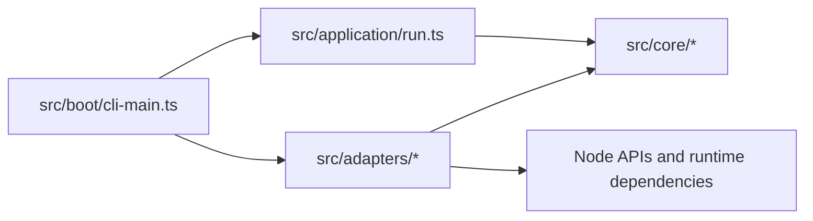

# Architecture

pathsift is one CLI package with TypeScript source and a hexagonal dependency direction.

## Source layout

Generated from the repository root with `node bin/pathsift.cjs tree src --parent ""`. This loads the root `.gitignore` before scanning `src/`. The machine-specific absolute root line is shown as `src/`, and the totals line is omitted.

```text
src/
├── adapters/
│   ├── output/
│   │   ├── cli-help.ts
│   │   └── terminal-output.ts
│   ├── config.ts
│   ├── ignore-walker.ts
│   ├── nano.ts
│   └── node-filesystem.ts
├── application/
│   └── run.ts
├── boot/
│   └── cli-main.ts
└── core/
    ├── buffer-policy.ts
    ├── output.ts
    ├── path-policy.ts
    ├── ports.ts
    ├── tree-digest.ts
    └── tree.ts
```

## Dependency direction



The checkout launcher `bin/pathsift.cjs` runs `src/boot/cli-main.ts` on Node 24+ and compiled `dist/boot/cli-main.js` on Node 22–23.

The application receives a `CommandPorts` object with path resolution, path checks, `walk`, destination prechecks, hashing, copy, and archive operations. It returns a `CommandOutput` value (`text` lines or a JSON value) rather than printing. The boot layer parses CLI arguments, constructs the Node adapter, and hands the result to the output adapter. Help uses a separate structured `HelpDocument`; its serializer and TTY renderer are CLI adapter responsibilities.

The output adapter checks stdout itself. A non-TTY receives plain text; `manifest` always receives plain JSON so pipelines can parse it. An interactive terminal with adequate width uses Ink/React for text and help. Errors go to stderr outside the JSON document. The `nano` adapter manages its own TTY and raw input separately.

The `hash` use case streams content SHA-256 through the Node port, hashes each relative filename separately, combines its digest with the content digest, then absorbs path-ordered file hashes into a tree digest. Only visible regular files participate. The exact encoding and the structural-change argument are in [the hash contract](hash.md).

The pure tree renderer groups children at each level into directories followed by files and symlinks, sorting names within each group. The walker keeps each directory's ignore scopes local. When a later rule rescues a directory ignored by an earlier scope, it creates a matcher for that subtree instead of changing a matcher shared with siblings. Symlinked directories are reported but not traversed. `src/core/path-policy.ts` flags parent-relative paths for explicit `--force` opt-in; the Node adapter checks that export targets are absent or empty before the walk. The walker skips an empty output path inside the source, avoiding self-inclusion. The adapter buffers exports in memory up to the configured visible-file byte threshold and otherwise writes directly; either path rolls back handled failures to the target's previous absent or empty state. Abrupt termination is outside that guarantee. Open directory handles do not create mandatory locks against unrelated processes.

With `--parent`, the walker reads selected ignore files along the ancestor chain to the source, then performs its normal walk from the source. It reads no sibling entries on that ancestor chain. The Node adapter compares real paths for ancestry so equivalent paths through aliases, such as `/var` and `/private/var` on macOS, select the same directory. Results and file hashes stay relative to the user-selected source.

Build emits only JavaScript under `dist/`, rewrites `.ts` imports to `.js`, and marks the compiled CLI entry executable. Packaging constructs a separate directory with compiled JavaScript, the npm usage README, and production metadata; the repository root keeps its project README. The package `bin` points directly at compiled JavaScript. The build and three-stage test contract is documented in the source checkout under `docs/build.md` and `docs/development.md`.
